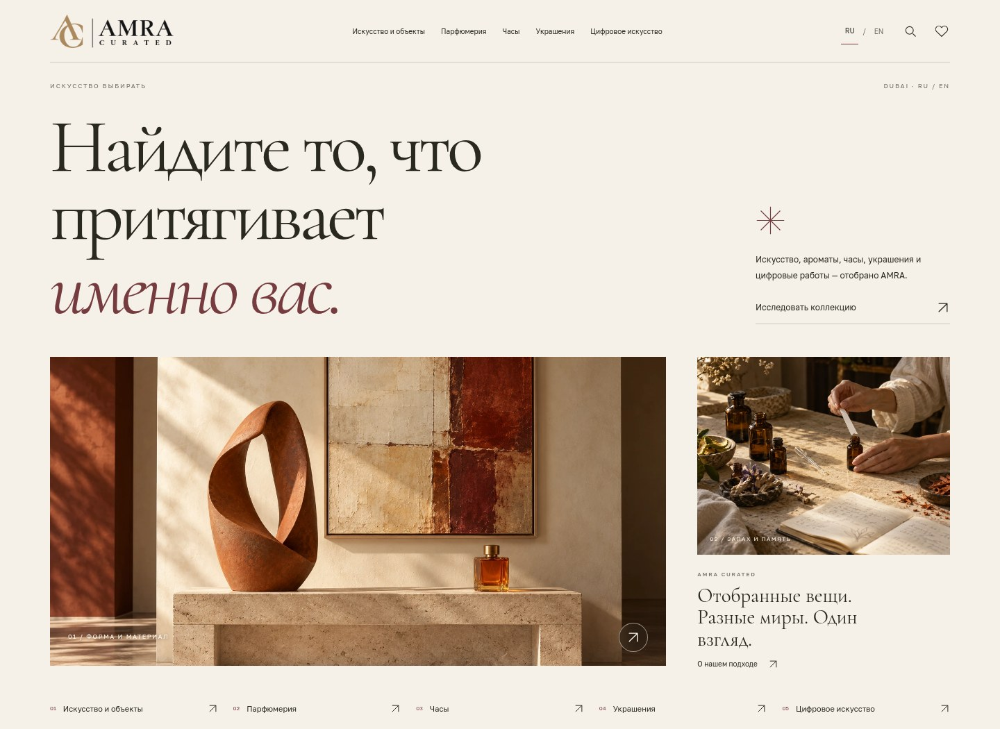

# AMRA — warm editorial edition

The original v37 site is preserved at commit `99663e5fd0b025e37478691a907a61a55381b08e` on `archive/original-v37`. The new visual edition lives on `design/warm-editorial`.

The redesign uses warm paper, fine rules, Cormorant Garamond headlines, Golos Text body copy, burgundy accents and a deep olive digital-art chapter. The homepage has a new editorial composition and an index of the five collection disciplines. Public collection, object, saved-item, contact and seller pages share the new visual system. Catalog records, translations, acquisition information, submission handlers and team administration remain in place.

Fonts are self-hosted in `public/fonts/`, with their OFL licenses. No external font service is required. Motion uses small entrance and hover transitions and respects `prefers-reduced-motion`.

## Development

Use Node.js 24 and pnpm 11.25.0. Run `pnpm install --frozen-lockfile` and `pnpm dev`. The page shell lives in `site/index.html`; dev/build regenerates `lib/index-html.ts`. The new hero is `public/atelier-hero.js`; the visual system is `public/editorial.css`.

Validation: `pnpm build`, `pnpm exec tsc --noEmit`, `node tests/submissions-local.mjs`, and `node tests/cms-local.mjs`. The repository's existing ESLint errors are unrelated to this design edition.

## Verified design review

42 browser checks passed in Chromium: catalog, category filters, sorting, saved-item persistence, object pages, search, language switching, editorial selections, digital selection and mobile menu navigation. Home, collection, digital, about, makers, contact, seller and sourcing routes were checked at 1440, 768, 390 and 320 px without horizontal overflow or broken images. All 34 handler checks, production build and TypeScript checking passed.

[Mobile design](design/mobile.jpg)
